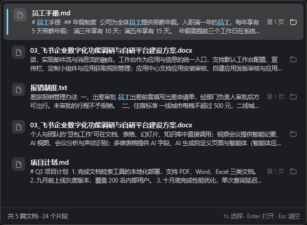

# DocuFind · 文档秒查


把文档拖进任务栏上的搜索框，之后一句话搜到里面任何内容。
**Windows 11 原生**（C# + WinUI 3）· 全本地 · 不联网 · 无 GPU 依赖。

装好之后它就安静地待在任务栏里，需要时按 `Ctrl + Alt + Space` 叫出来。
不用注册、不用 API Key，也不往云端传任何东西。


> 20 秒看完：拖进去、打一句话、直接跳到你记得的那一段。[看 1200×675 版](assets/readme/docufind-promo.mp4)

## 下载安装

> **Windows 11 x64 · 71.7 MB · 免管理员**
>
> **⬇ [下载 DocuFind-Setup-1.0.0.exe](https://gitee.com/kevin-anycode/DocuFind/releases/download/v1.0.0/DocuFind-Setup-1.0.0.exe)**
>
> 双击安装 → 开始菜单出现「DocuFind」→ 打开后把文件拖到胶囊上就能搜了。

- 装到 `%LOCALAPPDATA%\Programs\DocuFind`，不需要管理员权限，也不会动系统目录
- **自带 .NET 8 和 Windows App SDK 运行时**，目标机器不用另装任何东西
- 模型（23 MB）已经打进安装包，装完就能语义检索
- 卸载在「设置 → 应用」里；索引和设置留在 `%LOCALAPPDATA%\DocuFind`，想彻底清干净删掉这个目录即可
- 首次启动如果 Windows 拦了「未知发布者」，是因为安装包没有代码签名，点「更多信息 → 仍要运行」

## 它长什么样

装好之后，任务栏右边那块空档里会多出这样一条：


- 默认停在任务栏**最右边那块空档**：贴着右侧那一簇（媒体卡片 / 天气 / 托盘），不压住任何已有图标；
  挂件增减时自己往左或往右找位置。
- 按住左边那颗放大镜可以左右拖，松手落回默认位置就恢复自动跟随。
- 点一下胶囊就能打字，结果从任务栏上方弹出，**不抢焦点**——输入和上下键始终留在胶囊里。

点开打字，结果就从上方弹出来：



结果行显示文件名、命中片段（关键词高亮）和页码；`Enter` 打开文档，右键或行尾按钮可以直接打开所在文件夹。
一屏看不下时滚轮翻，`↑` `↓` 换选中行。

## 为什么系统自带的搜索不够用

举个几乎每个人都遇到过的场景：你想确认「出差住宿一晚不超过多少钱」，
记得这话是自己半年前写进某份制度里的，但想不起文件叫什么。

于是你在开始菜单里搜「住宿」——没有结果；在资源管理器里搜「住宿」——只有几个标题里带这两个字的文件；
最后打开猜的三四个 docx，一个个 `Ctrl + F` 翻。

Windows 自带的搜索有几个绕不过去的毛病：

1. **只认被索引的目录**。文档库、桌面、下载这些默认位置会索引，D 盘、网盘、U 盘、公司共享盘里的东西它不知道；
   索引没建完之前搜什么都是空的。
2. **基本只看文件名**。正文能不能搜到取决于格式、位置和索引状态，docx / pdf 经常搜不出内容。
3. **不认同义词**。搜「年假」找不到「带薪休假」，搜「报销」找不到「费用核销」。
4. **结果只是一条文件路径**。点开之后还得自己在文档里再找那句话。
5. 偶尔还会把网页搜索结果混进来——它更想让你用必应。

DocuFind 换了个思路：**文件由你决定放进来**，放进来之后内容就变成可搜索的，而且只在本机。

## 它是给谁用的

- 电脑里堆着几百份制度、方案、周报、合同、课程笔记，文件名起得随意；
- 找东西时**记得内容、不记得文件名**；
- 不想为了搜一份公司文档，把文件传到某个在线服务上；
- 也不想为了搜一段话，先把整个硬盘建成一个巨大的索引。

## 和常见做法比一比

| 你的问题是… | Windows 自带搜索 | Everything | 自己翻文件夹 | DocuFind |
| --- | --- | --- | --- | --- |
| 记得内容、不记得文件名？ | 看格式和索引，经常只剩文件名 | 搜不到，它只认文件名 | 打开猜的几个文件 Ctrl+F | ✅ 直接搜正文 |
| 换个说法还认吗？（年假 / 带薪休假） | 不认，得用原文里的词 | 不认，是精确匹配 | 靠你自己的记忆 | ✅ 意思接近就能中 |
| D 盘、网盘、公司共享盘算数吗？ | 没被索引就查不到 | 全盘都能搜 | 想得起来就翻得到 | 拖进去的都算 |
| 一次要等多久？ | 常常几秒，看索引状态 | 毫秒级 | 分钟级 | 1–22 ms |
| 最后给你什么？ | 一个文件 | 一个文件 | 一个文件 | 文件名 + 那句话 + 页码 |
| 要联网吗？ | 可能夹带网页结果 | 不用 | 不用 | 不用 |
| 平时怎么叫出来？ | 开始菜单 | 后台常驻 + 热键 | 打开资源管理器 | 任务栏胶囊 + 热键 |

> 说句公道话，这三个不冲突，我平时都开着：
>
> - **Everything** 在「找文件」这件事上依然最好用——全盘、秒出、内存占用极小，配个 EverythingToolbar 也能坐进任务栏，它只是「只认文件名」。
> - **Windows 自带搜索** 胜在不用装、和系统长在一起，找设置、找应用、找最近打开的文档都够用。
> - **DocuFind** 只补一个缺口：你记得那句话、但不记得文件名的时候，能直接翻到那一段。

## 怎么用

| 操作 | 说明 |
| --- | --- |
| `Ctrl + Alt + Space` | 呼出 / 收起 |
| 拖文件到胶囊上 | 加入知识库（可拖整个文件夹） |
| 输入 | 边打边搜，`↑` `↓` 选择，`Enter` 打开 |
| `Esc` | 清空输入；再按一次收起 |
| `Ctrl + O` | 选择文件导入 |
| 点右侧小图标 | 添加文件 / 清空知识库 / 退出 |

第一次用只要拖一份文件进去，它会在后台解析、切块、算向量，几十毫秒后就能搜了。
重名文档会当场问一句（覆盖 / 保留两份 / 跳过），内容完全相同的文件按哈希去重，不会重复入库。

## 它怎么做到住在任务栏里

Windows 11 没有给第三方留任务栏槽位 API。把窗口 `SetParent` 到 `Shell_TrayWnd` 能画进任务栏，
但跨进程子窗口拿不到前台和键盘焦点（`SetForegroundWindow` 直接返回 `False`），而输入框正是这个工具的核心。

所以用的是和汽水音乐播放条同一套做法：**一个像素对齐、压在任务栏上的顶层窗口**（`WS_EX_TOPMOST`），
再自己解决「看起来像长在里面」的问题：

- **位置**：窗口只占任务栏那一条；左侧用 UI Automation 探到的图标行右缘当硬下限（`TaskbarProbe`，每秒一次），
  右侧避开媒体卡片 / 天气 / 托盘，取最近的空档。任务栏把自己提到最上层时，250 ms 内会压回去。
- **配色**：窗口本身不透明，普通半透明色只会和窗口底混在一起（看着发灰）。所以每次摆位时直接读任务栏在胶囊背后的真实颜色
  （横向取 5 个点做渐变），窗口矩形铺成这个颜色，胶囊再用「它 + 14.5% 白」画渐变——
  壁纸、强调色、任务栏透明度怎么变都跟得上，代码里没有硬编码的任务栏色。
- **圆角**：不能用 `SetWindowRgn` 裁窗口（区域是 1 位掩码，两端会有台阶状锯齿）。
  现在窗口是矩形，圆角交给 XAML 抗锯齿绘制，多出来的四个小三角正好被上面那个任务栏色盖住。

## 怎么搜得准


- **切片**：按段落断句，聚合约 450 字一块、块间 60 字重叠，保留页码与字符偏移用于定位。
- **嵌入**：`bge-small-zh-v1.5`（24M 参数 / 512 维）的 INT8 ONNX，22.8 MB，纯 CPU 单句 5–10 ms。中文检索在第一梯队，体积是同级里最小的。
- **双通道**：向量通道做全量余弦（SIMD 暴力扫描，十万级切片几毫秒）；关键词通道走 SQLite FTS5 `trigram`，≥3 字走全文索引、2 字中文词回退 `LIKE`。
  只靠向量会漏掉编号 / 人名 / 精确词，只靠关键词又搜不到同义表达。
- **融合**：Reciprocal Rank Fusion（k=60），两路都进同一个排序。
- **门槛**（这一条决定「会不会瞎给结果」）：向量通道要求绝对余弦 ≥ **0.42**，并且 ≥ 本次最好分 × **0.82**。
  bge 对任何中文都有 0.30–0.40 的底噪，不设门槛时随手打一串「啊啊啊啊」也能把整库排出来；
  实测真相关查询 top1 落在 0.46–0.70，无关内容都在 0.39 以下。两路都不够像，面板就老老实实显示「没有找到」。

## 从源码跑

只想用的话，上面的安装包就够了；下面是从源码构建：

```powershell
# 1. 拉模型（约 23 MB，只需一次）
powershell -ExecutionPolicy Bypass -File tools\fetch-model.ps1

# 2. 构建
dotnet build src\DocuFind.App\DocuFind.App.csproj

# 3. 运行
.\src\DocuFind.App\bin\Debug\net8.0-windows10.0.19041.0\win-x64\DocuFind.exe
```

`samples\` 里有几份样例文档，直接拖到胶囊上就能看到效果。
索引和设置在 `%LOCALAPPDATA%\DocuFind\`（单文件 SQLite，`index.db`），删掉这个目录就等于清空。

### 命令行

```powershell
dotnet run --project tools\DocuFind.Cli -- --self-test          # 端到端自检
dotnet run --project tools\DocuFind.Cli -- --ingest D:\文档      # 批量导入
dotnet run --project tools\DocuFind.Cli -- --query "年假几天"     # 检索
dotnet run --project tools\DocuFind.Cli -- --cosines "年假几天"   # 看余弦分布（调阈值）
```

## 支持范围

| 项 | 现在 |
| --- | --- |
| 格式 | PDF、Word（.docx）、Excel（.xlsx / .csv）、PPT（.pptx）、纯文本（.txt / .md，含 GB18030） |
| 单文件大小 | ≤ 100 MB |
| 检索语言 | 中文为主，中英混排可用 |
| 系统 | Windows 11（任务栏在底部、横向） |

## 已知限制

1. **扫描件 PDF 搜不到**。只提取文字层，不做 OCR；要支持需要接 `Windows.Media.Ocr`。
2. **Word / Excel / PPT 没有页码**，结果只显示文件名与片段；PDF 有页码。
3. **任务栏在顶部或竖排**时贴不进去，退回屏幕底部居中悬浮。
4. 向量索引全量驻留内存，约 `切片数 × 2 KB`（10 万切片 ≈ 200 MB）。
5. 托盘图标、开机自启、设置页、文档管理页、安装包还没做。

## 目录结构

<details>
<summary>展开</summary>

```
DocuFind.sln
src/
  DocuFind.Core/            解析 · 切片 · 嵌入 · 索引 · 检索（无 UI 依赖）
    Parsing/                PDF / Word / Excel / PPT / 文本
    Embedding/              WordPiece 分词器 + ONNX 推理
    Index/                  SQLite 存储 + 内存向量索引
    Search/                 混合检索、RRF 融合与相关度门槛
    Ingestion/              后台入库流水线
  DocuFind.App/             WinUI 3 外壳
    Views/PillWindow        胶囊窗口（外形、拖放、拖动、结果渲染）
    Interop/                热键、窗口裁剪、任务栏定位、图标行探测（UIA）
tools/
  fetch-model.ps1           下载模型
  DocuFind.Cli/             自检 / 批量导入 / 检索 / 调参
samples/                    样例文档
assets/readme/              README 配图
```

</details>

## 下一步

- [ ] 托盘图标 + 开机自启
- [ ] 设置页（热键、胶囊宽度/偏移、外观、相似度阈值）
- [ ] 文档管理页（列表、删除、重建索引）
- [ ] Inno Setup 安装包（自包含运行时，内嵌模型）
- [ ] 扫描件 OCR
- [ ] 结果面板也换成和胶囊同一套材质（目前面板底偏实，纯为可读性）

## 打赏

如果这个小工具帮你省下过找文件的时间，可以请我喝杯咖啡 ☕

<table>
  <tr>
    <td align="center"><br><sub>微信</sub></td>
    <td align="center"><br><sub>支付宝</sub></td>
  </tr>
</table>

打赏随意，不给也完全不影响使用——它一直是免费、开源的。
